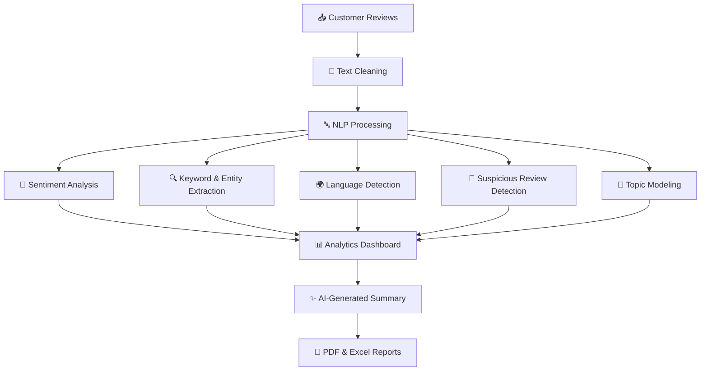
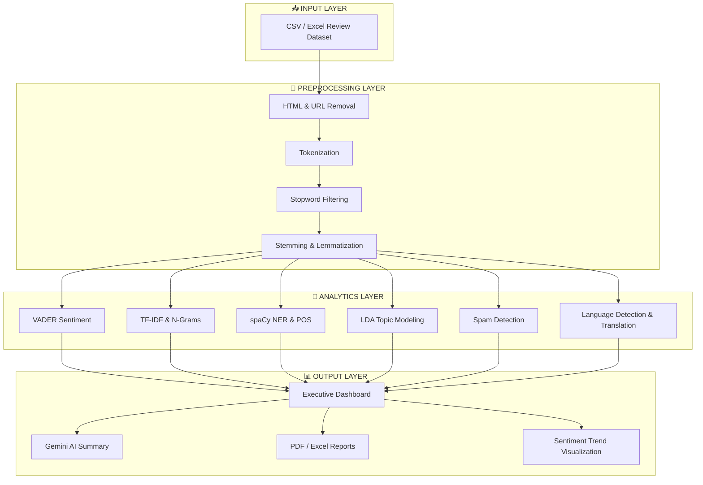

<div align="center">

# 🚀 ReviewPulse

### AI-Powered Customer Review Analytics & Intelligence Platform

**Turn Customer Feedback into Business Intelligence.**

An intelligent review analysis platform combining **Natural Language Processing (NLP), Machine Learning (ML), and Generative AI** to uncover customer sentiment, extract meaningful insights, detect suspicious reviews, and transform unstructured feedback into actionable business intelligence.

<br>


<br>

**💬 Analyze Reviews   •   🧠 Understand Sentiment   •   📊 Discover Insights   •   🤖 Empower Decisions**

</div>

---

## 📌 Table of Contents

* [🌟 Overview](#-overview)
* [🎯 Problem Statement](#-problem-statement)
* [💡 Our Solution](#-our-solution)
* [✨ Key Features](#-key-features)
* [📊 System Architecture](#-system-architecture)
* [🛠️ Technology Stack](#️-technology-stack)
* [🧠 NLP & Machine Learning Models](#-nlp--machine-learning-models)
* [📂 Dataset](#-dataset)
* [⚙️ How It Works](#️-how-it-works)
* [📈 Analytical Capabilities](#-analytical-capabilities)
* [📄 Report Generation](#-report-generation)
* [🚀 Getting Started](#-getting-started)
* [🔐 Privacy & Responsible Analysis](#-privacy--responsible-analysis)
* [🔮 Future Enhancements](#-future-enhancements)
* [🤝 Contributing](#-contributing)
* [📜 License](#-license)

---

## 🌟 Overview

**ReviewPulse** is an AI-powered customer review analysis platform designed to help businesses understand what customers think, feel, and expect from their products and services.

Customer reviews contain valuable information, but manually analyzing large volumes of feedback is time-consuming. Reviews may also contain HTML tags, unnecessary URLs, duplicate submissions, spam, and multiple languages.

ReviewPulse addresses these challenges through an integrated workflow that cleans customer feedback, processes text, analyzes sentiment, identifies important topics, and generates meaningful reports.

### 💎 What Makes ReviewPulse Special?

| Capability                     | Business Value                                           |
| :----------------------------- | :------------------------------------------------------- |
| 😊 Sentiment Intelligence      | Understand positive, negative, and neutral feedback.     |
| 🧹 Smart Text Processing       | Prepare messy reviews for meaningful analysis.           |
| 🔍 Keyword Extraction          | Discover frequently mentioned and informative terms.     |
| 🤖 Topic Discovery             | Identify recurring subjects in customer feedback.        |
| 🌍 Multilingual Support        | Detect and translate supported non-English reviews.      |
| 🚨 Suspicious Review Detection | Flag potentially fraudulent or spam-like submissions.    |
| 🧠 AI-Powered Summaries        | Convert review findings into readable business insights. |
| 📊 Interactive Analytics       | Explore patterns and sentiment trends.                   |
| 📄 Automated Reporting         | Export processed information into PDF and Excel reports. |

> **Our mission:** Make customer feedback easier to understand, analyze, and act upon.

---

## 🎯 Problem Statement

Businesses receive customer feedback through product reviews, online stores, and digital platforms. However, extracting useful insights from this feedback presents several challenges.

<table>
<tr>
<th>⚠️ Challenge</th>
<th>💭 Why It Matters</th>
</tr>
<tr>
<td>Unstructured Text</td>
<td>HTML tags, URLs, symbols, and inconsistent formatting complicate analysis.</td>
</tr>
<tr>
<td>Manual Review Analysis</td>
<td>Reading and categorizing reviews requires time and effort.</td>
</tr>
<tr>
<td>Hidden Customer Sentiment</td>
<td>Businesses need to understand whether feedback is positive, negative, or neutral.</td>
</tr>
<tr>
<td>Multiple Review Languages</td>
<td>Language differences can make customer feedback harder to analyze consistently.</td>
</tr>
<tr>
<td>Suspicious Submissions</td>
<td>Duplicates, spam, and repetitive content can affect the quality of insights.</td>
</tr>
<tr>
<td>Scattered Information</td>
<td>Important complaints, product strengths, and recurring topics may be difficult to identify.</td>
</tr>
</table>

### ❓ The Central Question

**How can we transform messy, unstructured customer reviews into organized, meaningful, and actionable business insights using NLP, Machine Learning, and Generative AI?**

ReviewPulse aims to answer this question through automated text processing, review analytics, and AI-assisted reporting.

---

## 💡 Our Solution

ReviewPulse brings multiple text analytics techniques together in one platform.



### 🔄 The Result

**Raw Feedback → Clean Text → Intelligent Analysis → Visual Insights → Actionable Recommendations**

Instead of manually examining every review, businesses can use ReviewPulse to explore customer sentiment, identify recurring concerns, and review summarized findings.

---

## ✨ Key Features

ReviewPulse provides **16 integrated modules** for customer review analysis.

|  #  | Feature                      | Description                                                                        | Technology                  |
| :-: | :--------------------------- | :--------------------------------------------------------------------------------- | :-------------------------- |
|  00 | 📊 Executive Dashboard       | Displays KPIs, sentiment distribution, suspicious-review counts, and AI summaries. | Dashboard, Gemini           |
|  01 | 🧹 Text Cleaning             | Removes HTML markup, URLs, and unwanted formatting.                                | Python, Regex               |
|  02 | 🔤 Tokenization              | Splits sentences into individual tokens and filters selected stopwords.            | spaCy, NLTK                 |
|  03 | 🌱 Stemming & Lemmatization  | Reduces words to stems or base forms.                                              | NLTK, spaCy                 |
|  04 | 😊 Sentiment Analysis        | Classifies reviews as positive, neutral, or negative.                              | VADER                       |
|  05 | 🏷️ Named Entity Recognition | Identifies entities such as organizations, locations, and dates.                   | spaCy                       |
|  06 | 📌 Keyword Extraction        | Finds frequent and informative terms in reviews.                                   | Counter, TF-IDF             |
|  07 | ☁️ Word Cloud                | Visualizes prominent words in the review corpus.                                   | WordCloud, Matplotlib       |
|  08 | 🔗 N-Gram Analysis           | Identifies two-word and three-word phrases.                                        | CountVectorizer             |
|  09 | 📝 POS Tagging               | Identifies grammatical roles such as nouns, verbs, and adjectives.                 | spaCy                       |
|  10 | 🔍 Pattern Extraction        | Detects email addresses, phone numbers, and order IDs using patterns.              | Regex                       |
|  11 | 📄 Report Export             | Generates PDF and Excel reports.                                                   | FPDF, openpyxl              |
|  12 | 🌍 Multilingual Analysis     | Detects review languages and translates supported text into English.               | langdetect, deep-translator |
|  13 | 🚨 Spam Detection            | Flags duplicate, unusually short, repetitive, or suspiciously formatted reviews.   | Rule-Based Engine           |
|  14 | 🤖 Topic Modeling            | Discovers recurring themes in the review collection.                               | Scikit-learn LDA            |
|  15 | 📈 Sentiment Trends          | Visualizes changes in sentiment across chronological periods.                      | Plotly                      |

### 🌟 Feature Highlights

<details>
<summary><b>😊 Intelligent Sentiment Analysis</b></summary>

ReviewPulse uses VADER to calculate sentiment scores and categorize customer reviews.

* **Positive:** Compound score ≥ 0.05
* **Neutral:** Compound score > -0.05 and < 0.05
* **Negative:** Compound score ≤ -0.05

Example:

> "The sound quality is amazing, but the battery life is terrible!"

This review contains both positive and negative opinions. Sentiment analysis helps identify the overall emotional tone, while other NLP techniques help identify the product aspects being discussed.

</details>

<details>
<summary><b>🧠 AI-Powered Review Summarization</b></summary>

The project integrates Google Gemini for generating executive summaries from customer feedback.

The summary workflow is designed to highlight:

* Customer praises.
* Common complaints.
* Potential improvement opportunities.
* Business recommendations.

If the Gemini API key is not configured, the documented implementation provides a deterministic-summary fallback.

</details>

<details>
<summary><b>🌍 Multilingual Review Processing</b></summary>

The multilingual module detects the language of review text and translates non-English reviews into English before downstream analysis.

The documented benchmark includes Spanish, French, German, Japanese, and Italian reviews.

This makes it easier to process feedback written in multiple supported languages through a common analysis pipeline.

</details>

<details>
<summary><b>🚨 Rule-Based Suspicious Review Detection</b></summary>

ReviewPulse checks for five suspicious patterns:

1. Duplicate review text.
2. Extremely short reviews.
3. Unnatural word repetition.
4. Excessive uppercase characters.
5. Excessive exclamation marks.

**Important:** These rules flag potentially suspicious reviews. They do not independently prove that a review is fake.

</details>

<details>
<summary><b>🤖 Topic Modeling with LDA</b></summary>

Latent Dirichlet Allocation identifies recurring word patterns that may represent broader topics.

For example, a review collection might contain topics related to:

* 🔊 Sound quality.
* 🔋 Battery performance.
* 📦 Shipping and delivery.
* 🎧 Comfort and product design.

These are illustrative examples; the actual topics depend on the dataset and model output.

</details>

---

## 📊 System Architecture

ReviewPulse follows a modular analysis pipeline that separates text preparation, analytical processing, and result presentation.



---

## 🛠️ Technology Stack

ReviewPulse combines Python libraries, statistical NLP methods, machine learning, visualization tools, and a generative AI service.

| Category             | Technologies                  | Purpose                                                     |
| :------------------- | :---------------------------- | :---------------------------------------------------------- |
| Programming Language | Python                        | Core processing and analysis                                |
| NLP                  | spaCy, NLTK                   | Tokenization, linguistic processing, and entity recognition |
| Sentiment Analysis   | VADER Sentiment               | Rule-based sentiment scoring                                |
| Machine Learning     | Scikit-learn                  | Vectorization and topic modeling                            |
| Keyword Analysis     | TF-IDF, CountVectorizer       | Keyword scoring and phrase extraction                       |
| Topic Modeling       | Latent Dirichlet Allocation   | Discovery of recurring topics                               |
| Language Processing  | langdetect, deep-translator   | Language detection and translation                          |
| Generative AI        | Google Gemini API             | Executive summaries and recommendations                     |
| Visualization        | Matplotlib, WordCloud, Plotly | Visual exploration of analytical results                    |
| Report Generation    | FPDF, openpyxl                | PDF and Excel exports                                       |
| Pattern Matching     | Python Regex                  | Structured information extraction                           |

### 🧰 Core Libraries

| Library         | Official Documentation                                            |
| :-------------- | :---------------------------------------------------------------- |
| Python          | [python.org](https://www.python.org/)                             |
| spaCy           | [spacy.io](https://spacy.io/)                                     |
| NLTK            | [nltk.org](https://www.nltk.org/)                                 |
| VADER Sentiment | [GitHub Repository](https://github.com/cjhutto/vaderSentiment)    |
| Scikit-learn    | [scikit-learn.org](https://scikit-learn.org/)                     |
| Google Gemini   | [Gemini API Documentation](https://ai.google.dev/gemini-api/docs) |
| Plotly          | [plotly.com/python](https://plotly.com/python/)                   |

---

## 🧠 NLP & Machine Learning Models

### 1. VADER — Sentiment Intelligence

VADER evaluates sentiment using a rule-based approach designed for social text.

**Output:** Positive, neutral, and negative sentiment scores, along with a compound score.

### 2. spaCy — Linguistic Processing

spaCy processes text and provides linguistic annotations.

**Output:** Tokens, lemmas, grammatical tags, and recognized entities.

### 3. TF-IDF — Important Term Extraction

TF-IDF measures how informative a term is within a document relative to a document collection.

**Output:** Weighted terms that can help identify meaningful review vocabulary.

### 4. LDA — Topic Discovery

LDA is an unsupervised probabilistic topic-modeling technique.

**Output:** Topic-word distributions and document-topic associations.

### 5. Gemini — Generative AI Summarization

Gemini processes the selected feedback provided to the model and generates a readable summary.

**Output:** Executive insights, customer complaints, praised features, and possible recommendations.

> **Different tools serve different purposes:** VADER analyzes sentiment, TF-IDF identifies informative terms, LDA discovers topics, and Gemini generates natural-language summaries.

---

## 📂 Dataset

ReviewPulse includes a benchmark dataset designed to test the application's ability to handle messy customer feedback.

### 📋 Dataset Overview

| Attribute         | Details                                                                    |
| :---------------- | :------------------------------------------------------------------------- |
| Dataset Files     | `dirty_reviews_master_dataset.csv` and `dirty_reviews_master_dataset.xlsx` |
| Product           | AcousticPro Max wireless noise-cancelling headphones                       |
| Number of Reviews | 20 sample reviews                                                          |
| Time Range        | November 2023 – May 2024                                                   |
| Record Identifier | `Review_ID`                                                                |
| Main Text Field   | `Review_Text`                                                              |
| Rating            | Integer from 1 to 5                                                        |
| Other Fields      | Date, Customer_Name, Product                                               |

### 🧪 Data Quality Scenarios

The dataset contains examples of:

* HTML tags and formatting.
* Raw URLs and unwanted links.
* Multilingual feedback.
* Spam and clickbait.
* Random or extremely short text.
* Duplicate submissions.
* Email addresses, phone numbers, and order IDs.

### 📑 Dataset Schema

| Column          | Description                  | Example                    |
| :-------------- | :--------------------------- | :------------------------- |
| `Review_ID`     | Unique review identifier     | `1001`                     |
| `Date`          | Date the review was recorded | `2023-11-04`               |
| `Customer_Name` | Reviewer label               | `Marcus Vance`             |
| `Rating`        | Star rating                  | `5`                        |
| `Product`       | Product being reviewed       | `AcousticPro Max`          |
| `Review_Text`   | Original review text         | `Excellent sound quality!` |

**Dataset note:** The included dataset is a synthesized benchmark. Its results should not be interpreted as representative of an actual product's customers without validation on real-world data.

---

## ⚙️ How It Works

ReviewPulse processes customer feedback through a series of analytical stages.

| Stage | Process                 | Result                                                             |
| :---: | :---------------------- | :----------------------------------------------------------------- |
|   01  | 📥 Load Reviews         | Read review records from supported dataset files.                  |
|   02  | 🧹 Clean Text           | Remove unwanted markup, URLs, and formatting.                      |
|   03  | 🔤 Process Words        | Tokenize text and apply selected filtering and normalization.      |
|   04  | 😊 Analyze Sentiment    | Calculate sentiment scores and categories.                         |
|   05  | 🔍 Extract Insights     | Identify keywords, phrases, entities, and grammatical information. |
|   06  | 🌍 Handle Languages     | Detect languages and translate supported reviews.                  |
|   07  | 🚨 Flag Suspicious Text | Apply predefined suspicious-review rules.                          |
|   08  | 🤖 Discover Topics      | Use LDA to identify recurring themes.                              |
|   09  | 📊 Visualize Results    | Present statistics, word clouds, and sentiment trends.             |
|   10  | ✨ Summarize Findings    | Generate AI-assisted executive summaries when configured.          |
|   11  | 📄 Export Reports       | Generate PDF and Excel outputs.                                    |

### 💬 Example Review

**Original review:**

> "The sound quality is amazing, but the battery life is terrible!"

**Potential analytical findings:**

| Analysis         | Example Result                                                  |
| :--------------- | :-------------------------------------------------------------- |
| Text Cleaning    | Removes unnecessary markup, if present                          |
| Keywords         | Sound quality, battery life                                     |
| N-Grams          | `sound quality`, `battery life`                                 |
| Sentiment        | Mixed positive and negative language                            |
| Topic            | Potential sound and battery-related concerns                    |
| Business Insight | Investigate battery performance while maintaining sound quality |

*The example above illustrates the types of insights the pipeline can support; it is not a claim about a specific recorded model output.*

---

## 📈 Analytical Capabilities

ReviewPulse provides several complementary ways to explore customer feedback.

### 😊 Sentiment Distribution

The dashboard is designed to display the distribution of positive, neutral, and negative reviews.

```text
Customer Reviews
       │
       ├── 😊 Positive
       ├── 😐 Neutral
       └── 😡 Negative
```

Actual percentages depend on the reviews processed. They should be calculated from model outputs rather than assumed in advance.

### ☁️ Word Cloud

Highlights prominent terms in the review collection.

**Example terms:**

`BATTERY` · `SOUND` · `QUALITY` · `DELIVERY` · `COMFORT`

### 🔗 Phrase Analysis

Examines frequently occurring combinations of two or three words.

| Bigram           | Trigram                   |
| :--------------- | :------------------------ |
| Sound quality    | Active noise cancellation |
| Battery life     | Crystal clear microphone  |
| Product delivery | Long battery performance  |

*These phrases are examples, not measured frequency rankings.*

### 📈 Chronological Sentiment Trends

The Plotly timeline can help users explore how review sentiment changes across dates or periods.

Potential uses include investigating:

* Increasing negative feedback.
* Changes in customer satisfaction.
* Periods with more product complaints.
* Possible relationships between operational events and feedback.

Temporal patterns indicate when changes occurred; they do not independently establish their causes.

---

## 📄 Report Generation

ReviewPulse supports exporting analysis results into two formats.

<table>
<tr>
<th>📕 PDF Report</th>
<th>📗 Excel Report</th>
</tr>
<tr>
<td>

* Executive summary
* KPI scorecards
* Sentiment charts
* Important keywords
* Readable report layout

</td>
<td>

* Processed review dataset
* Sentiment scores
* Extracted tokens
* Structured information
* Offline review and auditing

</td>
</tr>
</table>

**Goal:** Make analytical findings easier to share, review, and use in business discussions.

---

## 🚀 Getting Started

Follow these steps to set up the project locally.

### Prerequisites

Install the following before starting:

* Python.
* Git.
* A code editor such as Visual Studio Code.
* A Gemini API key if you want to use the Gemini integration.

### 1️⃣ Clone the Repository

Replace `<your-username>` with your GitHub username.

```bash
git clone https://github.com/<your-username>/ReviewPulse.git
```

Navigate to the project directory:

```bash
cd ReviewPulse
```

### 2️⃣ Create a Virtual Environment

```bash
python -m venv venv
```

Activate it.

**Windows:**

```bash
venv\Scripts\activate
```

**macOS / Linux:**

```bash
source venv/bin/activate
```

### 3️⃣ Install Dependencies

If your repository contains a `requirements.txt` file:

```bash
pip install -r requirements.txt
```

The project documentation references libraries including:

```text
spacy
nltk
vaderSentiment
scikit-learn
pandas
numpy
langdetect
deep-translator
wordcloud
matplotlib
plotly
fpdf
openpyxl
google-generativeai
```

Install the dependencies appropriate to your actual project and its pinned versions. The list above is a starting reference, not a verified replacement for your project's dependency file.

### 4️⃣ Download the spaCy Language Model

The documented implementation uses the English small model:

```bash
python -m spacy download en_core_web_sm
```

### 5️⃣ Configure Gemini AI

If your implementation uses the Gemini integration, create an API key and configure it through an environment variable or your project's existing configuration system.

For example, in a terminal:

**Windows PowerShell:**

```powershell
$env:GEMINI_API_KEY="your_api_key_here"
```

**macOS / Linux:**

```bash
export GEMINI_API_KEY="your_api_key_here"
```

Use the environment-variable name expected by your actual code. Never commit API keys or other secrets to GitHub.

### 6️⃣ Run the Application

The exact startup command depends on the entry point in your repository.

For example, if the project contains a Python entry-point file:

```bash
python app.py
```

Replace `app.py` with the actual entry-point filename. If your dashboard uses a framework-specific command, use the command defined by your project.

**Before publishing:** Verify the repository structure, dependency file, configuration names, and startup command so the installation instructions match the actual implementation.

---

## 🔐 Privacy & Responsible Analysis

ReviewPulse can encounter sensitive information in customer feedback, including email addresses, phone numbers, and order identifiers.

Responsible handling should include:

* 🔒 Keeping API keys and credentials outside version control.
* 🛡️ Restricting access to sensitive review data.
* 🧹 Avoiding unnecessary storage of personal information.
* 🌐 Reviewing privacy requirements before sending reviews to external AI or translation services.
* 🚨 Treating suspicious-review flags as indicators rather than definitive proof of fraud.
* 🧪 Evaluating analytical accuracy before using results for important business decisions.

**Important:** Pattern extraction identifies information; it does not automatically anonymize, encrypt, or securely store it.

---

## 🔮 Future Enhancements

The following are potential improvements, not claims about existing functionality.

| Enhancement                        | Potential Benefit                                               |
| :--------------------------------- | :-------------------------------------------------------------- |
| 📦 Larger Real-World Datasets      | Evaluate performance on more diverse customer feedback.         |
| 🎯 Aspect-Based Sentiment Analysis | Separate sentiment about battery, sound, comfort, and delivery. |
| 🌐 Expanded Language Support       | Improve processing for more languages.                          |
| 🧪 Advanced Fake Review Detection  | Combine text patterns with additional evidence and validation.  |
| 📊 Interactive Filters             | Filter insights by rating, product, date, and sentiment.        |
| ⚡ Real-Time Review Processing      | Analyze newly submitted feedback automatically.                 |
| 🔔 Complaint Alerts                | Notify businesses about increases in negative feedback.         |
| 🔐 Stronger Privacy Controls       | Improve sensitive-data handling and access management.          |
| 📈 Model Evaluation Dashboard      | Measure precision, recall, and other relevant metrics.          |

---

## 🤝 Contributing

Contributions, suggestions, and improvements are welcome!

1. Fork the repository.
2. Create a feature branch.
3. Implement your changes.
4. Test your implementation.
5. Submit a pull request with a clear explanation.

For larger changes, open an issue first to discuss the proposed enhancement.

---

## 📜 License

Choose and add a license file that matches how you want others to use, modify, and distribute your project.

Until a license is selected and added, do not assume the repository grants permission for reuse.

---

<div align="center">

## 💜 Built to Turn Feedback into Insight

**ReviewPulse — Listen to Customers. Discover Patterns. Make Better Decisions.**

*Powered by NLP · Machine Learning · Generative AI*

<br>

⭐ **If you find this project interesting, consider giving the repository a star!** ⭐

</div>
